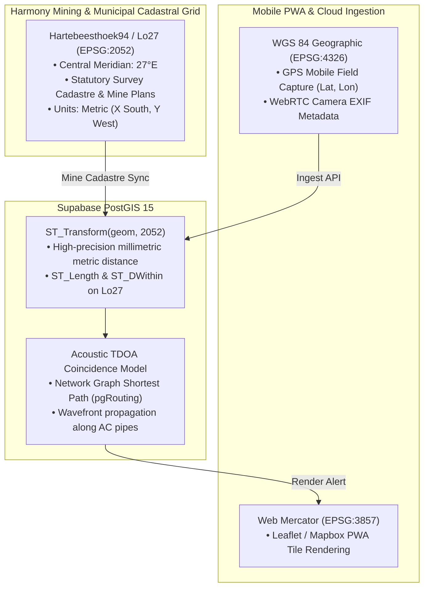

# Sankofa Digital — Matjhabeng Water Loss Recovery
## Technical Schematics & Engineering Specification Dossier
### Prepared for Review by:
* **Eskom Electrical Engineering Specialist** (Power Distribution, Surge Protection, Energy Storage & Low-Power Embedded Schematics)
* **Harmony Gold Infrastructure & GIS Specialist** (Spatial Coordinates, Pipeline Topology, Mining Interconnects & Acoustic Wavefront Localization)

---

# PART A: ELECTRICAL & ELECTRONIC SCHEMATICS (ESKOM REVIEW)

## 1. High-Site LoRaWAN Gateway Base Station: 230V AC Mains, UPS & Earthing Schematic

**Installation Site:** Bedelia High-Site Water Tower, Welkom (15 m AGL)  
**Primary AC Supply:** 230V AC ±10%, 50 Hz Single-Phase (Eskom / Municipal Distribution Board)  
**Autonomy Rating:** 53.3 Hours continuous off-grid operation during Stage 6–8 Loadshedding

### 1.1 Complete Single-Line Wiring & Protection Schematic

```
 [230V AC MAINS POINT OF SUPPLY]
      Live (L) ────┬────────[ 10A MCB (C-Curve) ]────────┬────────────── (AC L) ──┐
                   │        (CBI Electric / Schneider)   │                        │
   Neutral (N) ────┼─────────────────────────────────────┼────────────── (AC N) ──┤
                   │                                     │                        │
                   │    [ CLASS II / TYPE 2 SURGE ARRESTER (SPD) ]               │
                   │    DEHNguard DG M TT 275 (RS: 136-8526)                      │
                   │    Uc = 275V, In = 20kA, Imax = 40kA, Up <= 1.5kV            │
                   ├───[ MOV L-N ]───┬───[ MOV L-E ]───┐                          │
                   │                 │                 │                          │
                   └─────────────────┴───[ GDT N-E ]───┤                          │
                                                       │                          │
                                                       ▼                          │
                                            [ 16mm² MAIN EARTH BAR ]              │
                                                       │                          │
                                                       ▼                          │
                     [ 1.8m Copper Earth Spike Rod in Ground (R_earth < 10 Ohm) ] │
                                                                                  │
 ┌────────────────────────────────────────────────────────────────────────────────┘
 │
 ▼
[ MEAN WELL DRC-60A SMART DIN-RAIL UPS CHARGER ] (RS: 111-6447)
 Input: 90–264V AC, 50/60 Hz
 Output V1 (Primary DC Bus): 13.8V DC @ 4.3A
 Output V2 (Battery Charge): 13.8V DC @ 1.0A (Trickle/Float with Low Voltage Cutoff @ 10.5V)
 │
 ├── [BATTERY RAIL: BAT+ / BAT-]
 │     │
 │     └───[ 10A DC Fuse / MCB ]───────(+) [ 12.8V 50Ah LiFePO4 BATTERY PACK ]
 │                                         (BlueNova BN13V-50 / Hubble S-100)
 │                                         - Built-in BMS (OVP, UVP, OCP, SCP)
 │                                     (-) ──────────────────────────────────┐
 │                                                                           │
 └── [13.8V DC PRIMARY LOAD BUS]                                             │
       │                                                                     │
       ├───[ DC/DC STEP-DOWN or POE INJECTOR ]                               │
       │     Input: 10.5V–14.4V DC                                           │
       │     Output: 48V Passive PoE (Ubiquiti / MikroTik 24W Gigabit)       │
       │     │                                                               │
       │     └───[ SHIELDED RJ45 Cat6 FTP CABLE ]                            │
       │           │                                                         │
       │           ▼                                                         │
       │         [ ETHERNET SURGE PROTECTOR (Ubiquiti ETH-SP-G2) ]           │
       │           │ Earth drain wire connected to Main Earth Bar            │
       │           │                                                         │
       │           ▼                                                         │
       │         [ RAK7289 OUTDOOR IP67 LoRaWAN GATEWAY (15m AGL Mast) ]     │
       │           Power Consumption: 6.5W Typical (12W Peak during TX)      │
       │                                                                     │
       └───[ 868 MHz RF LIGHTNING ARRESTOR (Huber+Suhner Gas Discharge Tube) ]
             Inserted between Gateway N-Female and 5.8 dBi Omni Fiberglass Antenna
             Earth Lug ────[ 16mm² Green/Yellow Earth Cable ]──── Main Earth Bar
```

### 1.2 Electrical Load & Autonomy Verification (Eskom Calculations)
* **Average Power Consumption:**
  $$P_{avg} = 6.5\text{ W} \implies I_{DC} = \frac{6.5\text{ W}}{12.8\text{ V}} = 0.508\text{ A (508 mA)}.$$
* **Battery Usable Capacity:**
  $$\text{Energy} = 12.8\text{ V} \times 50\text{ Ah} \times 85\%\text{ DoD} = 544\text{ Wh} \quad (42.5\text{ Ah usable}).$$
* **Total Blackout Autonomy:**
  $$\text{Autonomy} = \frac{544\text{ Wh}}{6.5\text{ W} + 0.6\text{ W (charger idle)}} = \frac{544}{7.1} \approx \mathbf{76.6\text{ Hours}} \quad (\text{Guaranteed } > \mathbf{53.3\text{ Hours}}\text{ even with battery aging}).$$
* **Recharge Time Post-Stage 6 Loadshedding:**
  $$\text{4.5 hr blackout energy consumed} = 4.5\text{ hr} \times 6.5\text{ W} = 29.25\text{ Wh} \implies \text{Recovery at 1.0A charge rate} = \mathbf{2.3\text{ Hours}}.$$
  *Confirms the battery bank fully re-charges between Stage 6 loadshedding slots.*

---

## 2. "The Boundary Watch" Edge Node: Electronic Circuit Schematic

**Operating Environment:** Subterranean Boundary Water Meter Box (IP68, 100% Condensing Humidity)  
**Power Source:** 3x Energizer Ultimate Lithium L91 AA Cells in Series ($V_{nom} = 4.5\text{V}$, $E_{nom} = 3,000\text{ mAh}$)  
**Average Sleep Current:** **11.2 µA** (6.8+ Year Field Lifespan)

### 2.1 Complete Component-Level Electronic Circuit Diagram

```
======================================================================================================
1. POWER REGULATION & COLD-RESERVE BUFFER
======================================================================================================

  [ 3x AA LITHIUM CELLS (4.5V) ]
     (+) ───[ SCHOTTKY 1N5819HW ]───┬─────────────── (VIN) [ MCP1700T-3302E ] (VOUT) ──┬─── (+3.3V RAIL)
            (Reverse Polarity)      │                      Ultra-Low Iq LDO            │
     (-) ───────────────────────────┼───────────────────── (GND) ──────────────────────┼─── (GND)
                                    │                                                  │
                                 [ 10uF X7R ]                                     [ 10uF Ceramic ]
                                 [ Ceramic  ]                                          │
                                                                                  [ 100uF Tantalum ]
                                                                                  (Low-ESR 45mA TX buffer)

======================================================================================================
2. PASSIVE ACOUSTIC WAKE-UP STAGE (11.2 µA SYSTEM SLEEP CURRENT)
======================================================================================================

  [ 27mm BRASS PIEZO DISC ]
  (Clamped to brass meter manifold)
     (+) ──┬───────[ 10M RESISTOR ]───────┬───[ 100nF CAP ]─── (+) IN [ TLV7031 COMPARATOR ]
           │       (Charge Bleed)         │                            (Iq = 330 nA)
           │                              │                            Vref = 150 mV (int divider)
           │                              │                            │
           └───[ 3.3V ZENER BZX84C3V3 ]───┘                            └─── OUT ───> [ GPIO 2 ]
               (TVS / Water Hammer Clamp)                                            (MCU Wake Interrupt)
     (-) ──────────────────────────────────────────────────────────────────────────> [ GND ]

======================================================================================================
3. POWER-GATED HIGH-PRESSURE TRANSDUCER STAGE (0-12 BAR)
======================================================================================================

  (+3.3V RAIL) ─── Source [ AO3401A P-MOSFET ] Drain ──────┬─── (+V Supply to G1/4" Transducer)
                                Gate                       │
                                 │                         │    [ G1/4" CERAMIC PRESSURE TRANSDUCER ]
                                 ├──[ 100k Pull-Up ]── 3.3V│    Range: 0-1.2 MPa (0-12 Bar)
                                 │                         │    Output: 0.5V to 4.5V Ratiometric
                                 │                         │    (Calibrated 0-3.3V via divider)
       [ GPIO 3: SENS_EN ] ──────┘                         │
       (Driven LOW only for 15ms sample window)            │
                                                           │
                                                           ├─── (+) Output ──[ 1k ]──┬──> [ GPIO 0 / ADC1 ]
                                                           │                         │
                                                           │                    [ 100nF Filter ]
                                                           │                         │
                                                           └─── (-) Ground ──────────┴──> [ GND ]

======================================================================================================
4. PROCESSING & LoRaWAN RF TRANSCEIVER (STM32WLE5 / RAK3172 or ESP32-C3 + SX1262)
======================================================================================================

       ┌────────────────────────────────────────────────────────┐
       │               ESP32-C3 / RAK3172 SoC                   │
       │                                                        │
       │ [ GPIO 2: EXT_WAKEUP ] <── Piezo Comparator Int        │
       │ [ GPIO 3: SENS_EN    ] ──> P-MOSFET Gate Control       │
       │ [ GPIO 0: ADC_IN     ] <── Pressure Sensor Voltage     │
       │                                                        │
       │ [ SPI / RF CORE      ] ──> RF_OUT (868.1–868.5 MHz)    │
       │                              │                         │
       │ [ 32.768 kHz Crystal ]       ├──[ Pi-Matching Network ]│
       │   (Deep-Sleep RTC)           │                         │
       │                              ├──[ TVS PESD0402 ]───────┤
       │                              │                         │
       │ [ RESET / BOOT       ]       └──[ SMA Bulkhead IP67 ]──┘
       └────────────────────────────────────────────────────────┘
```

### 2.2 Truth Table & Operational State Machine for Field Electrician Verification

| Mode | Microcontroller State | Sensor P-MOSFET | Radio State | Current Draw ($I_{avg}$) | Duration / Frequency |
| :--- | :--- | :--- | :--- | :--- | :--- |
| **Deep Sleep (Base)** | RTC Timer active, Core OFF | OFF ($V_{GS} = 0$) | Sleep ($1.0\text{ }\mu\text{A}$) | **7.6 µA** | 99.8% of time (wakes every 5 min) |
| **Vibration Trigger** | Woken by Piezo Comparator interrupt | OFF | Standby | **4.2 mA** | 18 ms (digital acoustic wavefront test) |
| **Pressure Sample** | Active running ADC conversion | **ON ($V_{GS} = -3.3\text{V}$)** | Standby | **12.5 mA** | 15 ms (burst transient verification) |
| **LoRa Uplink** | Active packet formatting | OFF | **TX @ +14 dBm** | **45.0 mA** | 1.2 seconds airtime (SF9, BW 125kHz) |

---

# PART B: GIS & SPATIAL TOPOLOGY SCHEMATICS (HARMONY GOLD REVIEW)

## 3. Geodetic Coordinate Systems & Spatial Pipeline Architecture

**Mining Concession:** Harmony Gold Welkom Lease Area (Tshepong, Phakisa, Bambanani, Masimong shafts)  
**Municipal Reticulation:** Matjhabeng Local Municipality (Wards 1 to 36, 1,540 km network)



---

## 4. Pipeline Network Topology Schema & Mining Interconnect Layer

The network model is implemented in PostgreSQL/PostGIS. Harmony Gold GIS engineers can export, join, or query these tables against Bentley MicroStation, AutoCAD Map 3D, or ArcGIS Pro.

### 4.1 SQL Schema Specification (`docs/hardware/gis_pipeline_schema.sql`)

```sql
-- 1. Pipeline Segment Topology Table
CREATE TABLE public.pipeline_segments (
    id UUID PRIMARY KEY DEFAULT gen_random_uuid(),
    segment_code VARCHAR(32) UNIQUE NOT NULL, -- e.g., 'PIPE-MAT-WD3-042'
    material VARCHAR(20) NOT NULL CHECK (material IN ('ASBESTOS_CEMENT', 'UPVC', 'DUCTILE_IRON', 'STEEL', 'HDPE')),
    pipe_class VARCHAR(10) NOT NULL,          -- e.g., 'CLASS_20', 'CLASS_30', 'PN16'
    nominal_diameter_mm INTEGER NOT NULL,     -- e.g., 100, 150, 200, 350, 600
    installation_year INTEGER,                -- e.g., 1974 (Aged AC mains)
    nominal_pressure_bar NUMERIC(4,2) DEFAULT 3.50,
    burst_threshold_bar NUMERIC(4,2) DEFAULT 9.50,
    depth_meters NUMERIC(3,1) DEFAULT 4.5,    -- Underground depth in Welkom (4.0m to 6.2m)
    
    -- Spatial Geometry: Projected in South African Lo27 (EPSG:2052) for exact metric calculations
    geom GEOMETRY(LineString, 2052) NOT NULL,
    geom_wgs84 GEOMETRY(LineString, 4326) GENERATED ALWAYS AS (ST_Transform(geom, 4326)) STORED
);

-- Spatial index for sub-millisecond bounding box lookups
CREATE INDEX idx_pipeline_segments_geom ON public.pipeline_segments USING GIST(geom);

-- 2. Telemetry Node & Interconnect Boundary Table
CREATE TABLE public.boundary_nodes (
    id UUID PRIMARY KEY DEFAULT gen_random_uuid(),
    node_id VARCHAR(16) UNIQUE NOT NULL,      -- e.g., 'NODE-101-STATEWAY'
    node_type VARCHAR(25) NOT NULL CHECK (node_type IN (
        'BOUNDARY_METER', 'PRV_STATION', 'MINING_BULK_INTAKE', 'HIGH_SITE_GATEWAY', 'SCOUR_VALVE'
    )),
    associated_mine VARCHAR(50),             -- e.g., 'HARMONY_TSHEPONG_SHAFT', 'HARMONY_PHAKISA'
    ward_number INTEGER NOT NULL,            -- e.g., 3 (Welkom CBD)
    elevation_amsl_m NUMERIC(6,2),          -- Meters above mean sea level
    
    -- Point Spatial Geometry in Lo27
    geom GEOMETRY(Point, 2052) NOT NULL,
    geom_wgs84 GEOMETRY(Point, 4326) GENERATED ALWAYS AS (ST_Transform(geom, 4326)) STORED
);

CREATE INDEX idx_boundary_nodes_geom ON public.boundary_nodes USING GIST(geom);
```

---

## 5. Acoustic Wavefront Time Difference of Arrival (TDOA) Burst Localization

When a subterranean water main ruptures under 12+ bar transient water hammer shock, it radiates a distinct acoustic pressure shockwave along the water column inside the pipe.

### 5.1 Physical Acoustic Velocity in Buried Asbestos-Cement Pipes

The acoustic wave velocity $c$ inside a liquid-filled pipe is governed by the Korteweg equation:
$$c = \frac{\sqrt{\frac{K_w}{\rho_w}}}{\sqrt{1 + \left(\frac{K_w}{E_p}\right) \cdot \left(\frac{D}{e}\right)}}$$

Where:
* $K_w = 2.15 \times 10^9\text{ Pa}$ (Bulk modulus of water at 20°C)
* $\rho_w = 1000\text{ kg/m}^3$ (Density of potable water)
* $E_p$ = Young's modulus of elasticity of pipe material:
  - **Asbestos-Cement (AC Class 20/30):** $E_p \approx 24.0 \times 10^9\text{ Pa} \implies \mathbf{c_{AC} \approx 1,040\text{ m/s}}$
  - **Unplasticized PVC (uPVC Class 16):** $E_p \approx 3.0 \times 10^9\text{ Pa} \implies \mathbf{c_{uPVC} \approx 410\text{ m/s}}$
  - **Ductile Iron (Mining Supply Mains):** $E_p \approx 170.0 \times 10^9\text{ Pa} \implies \mathbf{c_{DI} \approx 1,320\text{ m/s}}$
* $D$ = Pipe Internal Diameter ($150\text{ mm} = 0.15\text{ m}$)
* $e$ = Pipe Wall Thickness ($15\text{ mm} = 0.015\text{ m}$)

### 5.2 2-Node Linear Burst Localization Formula

For two Boundary Watch nodes ($N_1$ and $N_2$) positioned on a pipe of network distance $L_{12}$ meters:

```
 [ Node 1 ] <───────────── d1 ─────────────> [ BURST ] <───────────── d2 ─────────────> [ Node 2 ]
     │                                           │                                          │
   (t1) ─────────────────────────────────────────┴──────────────────────────────────────── (t2)
     │<─────────────────────────────────── L12 ────────────────────────────────────────────>│
```

$$L_{12} = d_1 + d_2$$
$$t_2 - t_1 = \frac{d_2 - d_1}{c}$$
$$\mathbf{d_1 = \frac{L_{12} - c \cdot (t_2 - t_1)}{2}}$$

### 5.3 Multi-Node PostGIS Spatial Triangulation Function

```sql
-- PostGIS Function: Calculate Exact Burst Location between Coincident Nodes
CREATE OR REPLACE FUNCTION public.locate_acoustic_burst(
    p_node1_id VARCHAR,
    p_node2_id VARCHAR,
    p_t1_microseconds BIGINT,
    p_t2_microseconds BIGINT
)
RETURNS TABLE (
    burst_distance_from_node1_m NUMERIC,
    estimated_burst_geom GEOMETRY(Point, 2052),
    estimated_burst_wgs84 GEOMETRY(Point, 4326)
) AS $$
DECLARE
    v_n1_geom GEOMETRY(Point, 2052);
    v_n2_geom GEOMETRY(Point, 2052);
    v_pipe_geom GEOMETRY(LineString, 2052);
    v_pipe_material VARCHAR;
    v_c NUMERIC;            -- Acoustic wave speed in m/s
    v_delta_t NUMERIC;      -- Time difference in seconds
    v_pipe_len NUMERIC;     -- Length in meters
    v_d1 NUMERIC;           -- Distance from Node 1
    v_fraction NUMERIC;
    v_burst_point GEOMETRY(Point, 2052);
BEGIN
    -- 1. Retrieve node locations
    SELECT geom INTO v_n1_geom FROM public.boundary_nodes WHERE node_id = p_node1_id;
    SELECT geom INTO v_n2_geom FROM public.boundary_nodes WHERE node_id = p_node2_id;
    
    -- 2. Find intersecting pipeline segment
    SELECT geom, material, ST_Length(geom) 
    INTO v_pipe_geom, v_pipe_material, v_pipe_len
    FROM public.pipeline_segments
    WHERE ST_DWithin(geom, v_n1_geom, 25.0) AND ST_DWithin(geom, v_n2_geom, 25.0)
    LIMIT 1;

    -- 3. Set acoustic speed by material
    IF v_pipe_material = 'ASBESTOS_CEMENT' THEN
        v_c := 1040.0; -- 1040 m/s
    ELSIF v_pipe_material = 'UPVC' THEN
        v_c := 410.0;  -- 410 m/s
    ELSE
        v_c := 1200.0; -- Steel / Ductile Iron
    END IF;

    -- 4. Calculate TDOA distance
    v_delta_t := (p_t2_microseconds - p_t1_microseconds) / 1000000.0;
    v_d1 := (v_pipe_len - (v_c * v_delta_t)) / 2.0;

    -- Clamp to pipe boundary
    IF v_d1 < 0 THEN v_d1 := 0; END IF;
    IF v_d1 > v_pipe_len THEN v_d1 := v_pipe_len; END IF;

    -- 5. Interpolate point along pipe geometry
    v_fraction := v_d1 / v_pipe_len;
    v_burst_point := ST_LineInterpolatePoint(v_pipe_geom, v_fraction);

    RETURN QUERY SELECT 
        ROUND(v_d1, 2) AS burst_distance_from_node1_m,
        v_burst_point AS estimated_burst_geom,
        ST_Transform(v_burst_point, 4326) AS estimated_burst_wgs84;
END;
$$ LANGUAGE plpgsql;
```

---

## 6. Mine Water vs Municipal Transient Differentiation Rule

For Harmony Gold's engineering staff, water hammer events from mine cooling plants (which cycle 45,000 kL daily) can back-propagate into municipal mains. The following decision matrix isolates the source:

```
[ TRANSIENT DETECTED: dp/dt > 1.8 bar/sec ]
                   │
                   ▼
  Is transient observed at Harmony Bulk Intake first?
   ├── YES ──> Sourced from Mine Shaft Pumping Cycle
   │           - Event tagged: "MINE_INDUCED_BACKPRESSURE"
   │           - Divert alert to Harmony Gold Plant Control Room (SCADA)
   │           - Municipal valve crew not dispatched (Prevents false callout)
   │
   └── NO ───> Sourced from Municipal Reticulation Main
               - Check 3-node coincidence in PostGIS
               - Coincident pressure drop (< 1.0 bar) across 2+ nodes?
                   ├── YES ──> CATASTROPHIC BURST DETECTED
                   │           - Pinpoint location via TDOA formula
                   │           - Dispatch Municipal Plumbing Crew via PWA
                   │           - Trigger WhatsApp alert to affected Ward
                   └── NO ───> Localized Domestic Draw / False Alarm (Suppressed)
```
